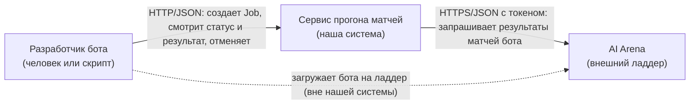
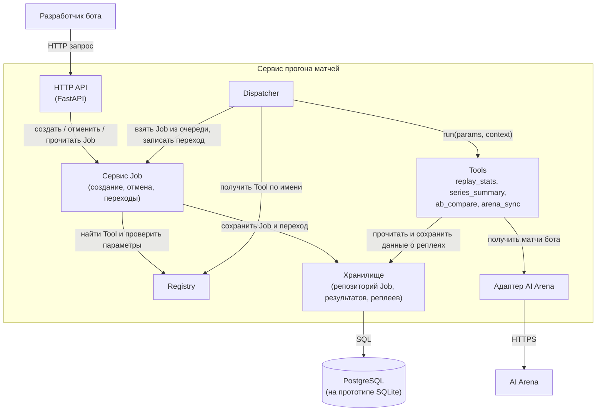
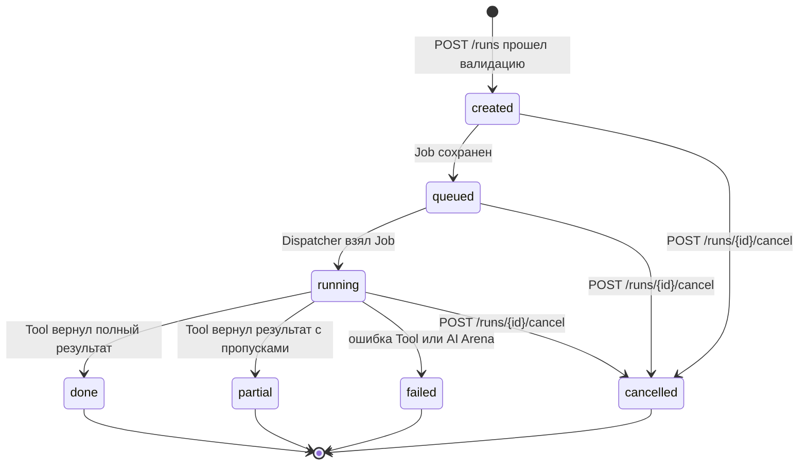

# Архитектура

Термины те же, что в [requirements.md](requirements.md): Job это прогон (в API `/runs`), исполнитель (Tool) это модуль с контрактом из [tool-contract.md](tool-contract.md).

## Контекст

Стрелки показывают, кто к кому обращается во время работы и по какому протоколу. Пунктир идет мимо нашего сервиса: бота на ладдер разработчик загружает сам.

Разработчик бота единственный пользователь. Он работает с сервисом через HTTP API, интерфейса нет. AI Arena единственная внешняя система: сервис ходит к ней сам, она к сервису не обращается. Клиент StarCraft II в основной схеме не участвует, он нужен только исполнителю `local_match`, который вынесен в отдельный профиль.

## Компоненты

Стрелки здесь это вызовы во время работы, от того, кто вызывает, к тому, кого вызывают. Зависимости кода идут так же, кроме одного места: ядро (сервис Job, Dispatcher, Registry, Tools) не импортирует FastAPI, SQLAlchemy и HTTP клиент. Оно знает только интерфейсы хранилища и адаптера, реализации подставляются при запуске. Поэтому ядро тестируем без базы и без сети.

| Компонент | За что отвечает | Что скрывает от соседей |
| --- | --- | --- |
| HTTP API | Принимает запросы, проверяет тело по OpenAPI, обрабатывает `Idempotency-Key`, переводит ошибки ядра в единый формат `{"error": {"code", "message", "correlation_id"}}` и HTTP коды, ставит `correlation_id` | FastAPI, HTTP коды и заголовки. Ядро про HTTP ничего не знает |
| Сервис Job | Создает Job, проверяет каждый переход по жизненному циклу и записывает его в историю, обрабатывает отмену | Правила жизненного цикла. Остальные компоненты просят сделать переход и получают либо успех, либо `invalid_transition` |
| Dispatcher | Берет Job из очереди, находит Tool, запускает его и по результату переводит Job в `done`, `partial` или `failed` | Как устроена очередь и как Job выполняется в фоне. Tools не знают, что их запускают из очереди |
| Registry | Хранит соответствие имени и Tool, отдает список для `GET /tools` | Список конкретных Tools. Новый Tool добавляется регистрацией, Dispatcher и сервис Job не меняются |
| Tools | Выполняют работу: разбор реплеев, подсчет побед, сравнение серий, синхронизация с AI Arena | Как именно считается результат. Наружу отдают только `ToolResult` или ошибку из контракта |
| Хранилище | Сохраняет и читает Job, историю переходов, результаты, данные о реплеях | СУБД, SQL и миграции. Переход с SQLite на PostgreSQL соседей не задевает |
| Адаптер AI Arena | Ходит в API AI Arena: таймаут 10 с, до 3 попыток на таймаут, 5xx и 429, разбор ответа | HTTP, токен, повторы и формат ответа AI Arena. Наружу отдает список матчей или ошибку `external_unavailable` / `external_bad_response` |

## Диаграмма состояний Job

Конечные состояния: `done`, `partial`, `failed`, `cancelled`. Подробные правила (что пишется в историю, что происходит с результатом при отмене) описаны в [requirements.md](requirements.md#жизненный-цикл-job).

### Запрещенные переходы

Разрешены только переходы со схемы выше, все остальные запрещены. Проверку делает сервис Job, проверка и запись нового состояния идут одной атомарной операцией.

| Попытка | Пример | Что ответит система |
| --- | --- | --- |
| Отменить Job в конечном состоянии | `POST /runs/{id}/cancel` для Job в `done`, `partial`, `failed` или `cancelled` | 409 `invalid_transition` в едином формате ошибки. Состояние и история не меняются |
| Запустить завершенный Job заново | Повторно выполнить Job в `done` или `failed` | Такой операции в API нет. Чтобы прогнать снова, создают новый Job через `POST /runs`, старый Job и его результат не меняются |
| Перейти из конечного состояния в любое другое | Dispatcher пытается записать `done` для Job, который уже `cancelled` | Сервис Job отклоняет переход с `invalid_transition`. Результат Tool отбрасывается, в лог пишется предупреждение с `correlation_id`. Клиент видит `cancelled` |
| Перескочить состояние | `created → running`, `queued → done`, `created → failed` | Сервис Job отклоняет переход с `invalid_transition`. Через API такую попытку сделать нельзя, это ошибка в коде, ее ловят тесты |
| Отменить несуществующий Job | `POST /runs/{id}/cancel` с неизвестным id | 404 `run_not_found` |
